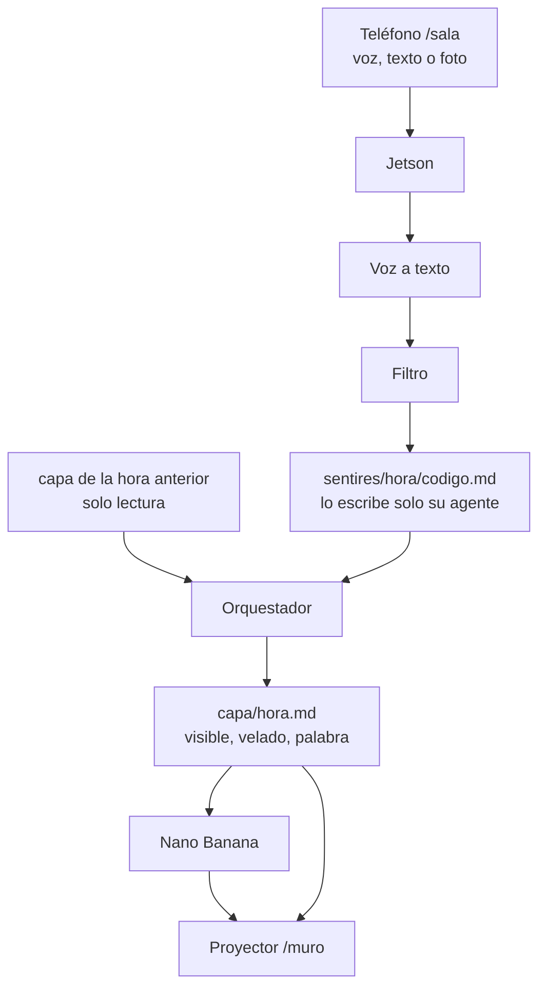

# Sincronía

Un mural para toda la sala. Se sigue pintando mientras la gente habla.

Platanus Hack Santiago 26, track Multiplayer.

## La idea

Cada persona dice qué siente y qué figura ve ahora. Su agente anota eso. Un orquestador decide qué queda visible, qué se tapa y qué palabra se escribe. La pared cambia. La hora anterior sigue leyéndose debajo.

Con una persona no hay nada que negociar. Con la segunda, el muro cambia. Lo que uno pide cambia lo que el otro logra dejar dentro.

El nombre sale de un estudio de públicos de teatro: los corazones de la sala se sincronizan, y más cuando el sentir dicho en voz converge (Ardizzi y otros, 2020). No medimos corazones. El mural es esa sincronía hecha visible. No decimos que cura.

## Las tres preguntas

Hay una sola sala. Se responden por voz, en un suspiro. También puede ser texto o una foto.

1. ¿Qué estás sintiendo ahora, en una imagen?
2. ¿Qué está sintiendo la sala, en una frase?
3. ¿Qué imagen, artefacto o figura visualizas en este momento?

La primera es la persona. La segunda es lo que cree que siente la sala. Si no coinciden, hay una capa que decidir. La tercera es lo que se pinta: en esa figura va todo lo que quiere transmitir.

## Cómo funciona

El teléfono abre la sala y recibe un código de cuatro letras. Ese código es el usuario y es su agente. No hay login.

Cada agente escribe solo su nota. Los demás pueden leerla. El orquestador es el único que escribe la capa de esa hora. El texto va dentro del muro, no como pie de foto. Al lado se ve qué dijo cada quien y qué propuso cada agente. No hay un puntaje de ánimo.

La figura acordada la pinta Nano Banana en el muro.

## Demo

A las 11 Ana dice luz y gente de pie. El muro es eso. A las 16 Ana dice alguien dormido en el teclado y Benja dice que siguen de pie. La luz queda debajo, arriba está el que duerme, y sobrevive la palabra «de pie».

## Qué entra el domingo

Webapp en la red local, sobre una Jetson. El proyector abre el muro. WhatsApp no entra.

Si sobra tiempo, la misma capa puede moverse un momento. Si no está, el muro basta.

## Stack

Una app Next.js, servida por la Jetson en la red del lugar. Dos pantallas: `/sala` en el teléfono y `/muro` en el proyector.

| Pieza | Dónde corre | Para qué |
| --- | --- | --- |
| Next.js | Jetson | La sala y el muro, en `jetson.local` |
| Voz del navegador | Teléfono, Chrome | Transcribe en español sin subir el audio |
| Whisper | Jetson | Si la voz del navegador falla, o si mandan un audio |
| Filtro | Jetson | Vacío, insulto sin figura u orden al agente: no entra a la nota |
| Agentes | xAI, llamados desde la Jetson | Uno por código, más el orquestador. La llave no sale del servidor |
| Nano Banana | Desde la Jetson | Pinta la figura que quedó en la capa |
| Tablero | Disco de la Jetson | `sentires/hora/codigo.md` y `capa/hora.md` |

El código de cuatro letras vive en el navegador. Cada agente escribe solo su archivo. El orquestador lee las notas de esa hora y la capa anterior, y es el único que escribe `capa/`. La hora que ya pasó no se reabre.

## La Jetson

No publica nada a internet. Corre la app, oye la voz cuando el teléfono no puede, y frena lo que no trae figura antes de que llegue al tablero. El proyector y los teléfonos hablan con ella por la red local. Los agentes y Nano Banana salen desde ahí hacia afuera.

## Flujo

## Ideas de complementación

No se construyen el domingo. Son lo que ya existe al lado, y lo que se puede sumar después.

Nadie hace la capa. Estos se le acercan:

- [Aura](https://github.com/ghubnerr/aura) vuelve video la emoción de una sola persona.
- [ArtAI](https://github.com/SilentByte/artai) toma títulos que la sala publica y genera imágenes. Suma pedidos, no negocia.
- [Este muro de graffiti](https://harshil.dev/writings/building-ai-graffiti-wall/) apila bocetos en una pared y los filtra. Cada dibujo se queda entero.
- [Gaze to the Stars](https://www.media.mit.edu/publications/gaze-to-the-stars-ai-and-public-art-from-personal-affect-and-collective-empathy/) (NeurIPS 2025) junta el sentir de mucha gente y lo proyecta. Agrupa. No abre una grieta.
- [Wonderland](https://github.com/theswerd/wonderland) muta un canvas compartido. Cualquiera pinta encima.
- [wePaintAI](https://github.com/wepaintai/wepaintai) deja dibujar a varios y pasa el boceto por Flux Kontext.
- [Emergent Atelier](https://www.emergentatelier.dev/) funde capas de varios agentes. Los humanos solo dejan un ánimo.
- [Room Film](https://github.com/jeanethS/room-film) elige una escena por ánimo. No hay mural.

De Emergent Atelier se puede tomar el fundido de capas. De Wonderland, pasarle al modelo la imagen de la hora anterior para que la nueva salga de esa.

### Un agente que pinte, en vez de Nano Banana

Existe. No es un modelo que escupe una foto: el agente mira el lienzo y pone trazos.

- [paint-mcp](https://github.com/Mishaadevv/paint-mcp) le da pinceles, capas y deshacer. Cada herramienta le devuelve la foto.
- [AgenticArt](https://github.com/miked63017/AgenticArt) pinta con el mismo pincel que una persona, trazo a trazo, en vivo.
- [drawing-skill](https://github.com/jchapuis/drawing-skill) escribe cada marca a mano. Una escena son cientos de miles de tokens.
- [DoodleAgent](https://github.com/YIFANK/DoodleAgent) elige pincel, color y coordenadas y vuelve a mirar el canvas. Hay paper de un workshop de ICCV 2025.
- [AgentBrush](https://github.com/hdelattre/AgentBrush), [ALIGN](https://github.com/wanshuiyin/ALIGN-Agentic-Loop-Image-GeneratioN) y [Agent Paint](https://lobehub.com/mcp/minebot17-agent-paint) hacen la misma vuelta: dibujar, mirar, corregir. Sin difusión.

Para el domingo no. Una pared tardaría minutos y se comería el presupuesto de tokens. El muro de la demo lo pinta una sola llamada, con la imagen de la hora anterior como referencia. Nano Banana, o [FLUX Kontext](https://huggingface.co/black-forest-labs/FLUX.1-Kontext-dev) si no hay llave de Google.

El complemento, cuando sobre tiempo, es ese pintor. El orquestador sigue decidiendo la capa. El agente de pintura pone los trazos encima, y la sala ve cómo se vela la hora anterior. Ahí el cineminuto sale solo: el video es la mano pintando, no un clip generado.

En la Jetson no cabe un FLUX. Cabe Whisper pequeño multilingüe, para cuando la voz del navegador falle. Los LoRA de caras tristes o enojadas de Hugging Face no sirven: etiquetan una expresión, no pintan la figura de la sala.

Instagram y publicar afuera quedan fuera. La obra es la pared de la sala.

## Notas

- [para-el-team.md](para-el-team.md) es el relato corto para el equipo.
- [idea-sincronia.md](idea-sincronia.md) es la idea completa. Al final queda lo que no se construye el domingo.
- [pitch.md](pitch.md) es la frase de los corazones y lo que no hay que decir.
- [system-prompt-mural.md](system-prompt-mural.md) es el prompt del orquestador.
- [sintesis-articulos-arte.md](sintesis-articulos-arte.md) resume los papers.
- [track-multiplayer.md](track-multiplayer.md) es la letra del track.
