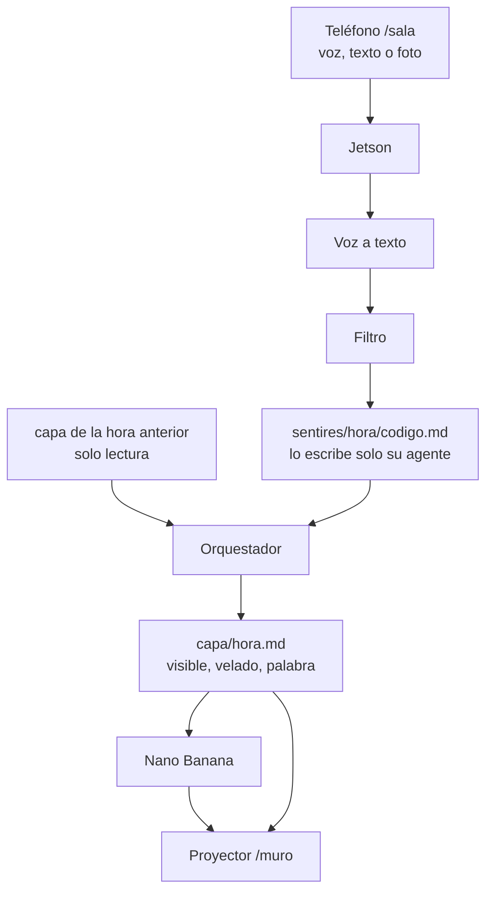

# Sincronía

Un mural para toda la sala. Se sigue pintando mientras la gente habla.

Platanus Hack Santiago 26, track Multiplayer.

## La idea

Cada persona dice qué siente y qué figura ve ahora. Su agente anota eso. Un orquestador decide qué queda visible, qué se tapa y qué palabra se escribe. La pared cambia. La hora anterior sigue leyéndose debajo.

Con una persona no hay nada que negociar. Con la segunda, el muro cambia. Lo que uno pide cambia lo que el otro logra dejar dentro.

El nombre sale de un estudio de públicos de teatro: los corazones de la sala se sincronizan, y más cuando el sentir dicho en voz converge (Ardizzi y otros, 2020). No medimos corazones. El mural es esa sincronía hecha visible. No decimos que cura.

## Las tres preguntas

Hay una sola sala. Se responden por voz, en un suspiro. También puede ser texto o una foto.

1. ¿Qué estás sintiendo ahora, en una imagen?
2. ¿Qué está sintiendo la sala, en una frase?
3. ¿Qué imagen, artefacto o figura visualizas en este momento?

La primera es la persona. La segunda es lo que cree que siente la sala. Si no coinciden, hay una capa que decidir. La tercera es lo que se pinta: en esa figura va todo lo que quiere transmitir.

## Cómo funciona

El teléfono abre la sala y recibe un código de cuatro letras. Ese código es el usuario y es su agente. No hay login.

Cada agente escribe solo su nota. Los demás pueden leerla. El orquestador es el único que escribe la capa de esa hora. El texto va dentro del muro, no como pie de foto. Al lado se ve qué dijo cada quien y qué propuso cada agente. No hay un puntaje de ánimo.

La figura acordada la pinta Nano Banana en el muro.

## Demo

A las 11 Ana dice luz y gente de pie. El muro es eso. A las 16 Ana dice alguien dormido en el teclado y Benja dice que siguen de pie. La luz queda debajo, arriba está el que duerme, y sobrevive la palabra «de pie».

## Qué entra el domingo

Webapp en la red local, sobre una Jetson. El proyector abre el muro. WhatsApp no entra.

Si sobra tiempo, la misma capa puede moverse un momento. Si no está, el muro basta.

## Stack

Una app Next.js, servida por la Jetson en la red del lugar. Dos pantallas: `/sala` en el teléfono y `/muro` en el proyector.

| Pieza | Dónde corre | Para qué |
| --- | --- | --- |
| Next.js | Jetson | La sala y el muro, en `jetson.local` |
| Voz del navegador | Teléfono, Chrome | Transcribe en español sin subir el audio |
| Whisper | Jetson | Si la voz del navegador falla, o si mandan un audio |
| Filtro | Jetson | Vacío, insulto sin figura u orden al agente: no entra a la nota |
| Agentes | xAI, llamados desde la Jetson | Uno por código, más el orquestador. La llave no sale del servidor |
| Nano Banana | Desde la Jetson | Pinta la figura que quedó en la capa |
| Tablero | Disco de la Jetson | `sentires/hora/codigo.md` y `capa/hora.md` |

El código de cuatro letras vive en el navegador. Cada agente escribe solo su archivo. El orquestador lee las notas de esa hora y la capa anterior, y es el único que escribe `capa/`. La hora que ya pasó no se reabre.

## La Jetson

No publica nada a internet. Corre la app, oye la voz cuando el teléfono no puede, y frena lo que no trae figura antes de que llegue al tablero. El proyector y los teléfonos hablan con ella por la red local. Los agentes y Nano Banana salen desde ahí hacia afuera.

## Flujo

## Notas

- [para-el-team.md](para-el-team.md) es el relato corto para el equipo.
- [idea-sincronia.md](idea-sincronia.md) es la idea completa. Al final queda lo que no se construye el domingo.
- [pitch.md](pitch.md) es la frase de los corazones y lo que no hay que decir.
- [system-prompt-mural.md](system-prompt-mural.md) es el prompt del orquestador.
- [sintesis-articulos-arte.md](sintesis-articulos-arte.md) resume los papers.
- [track-multiplayer.md](track-multiplayer.md) es la letra del track.
